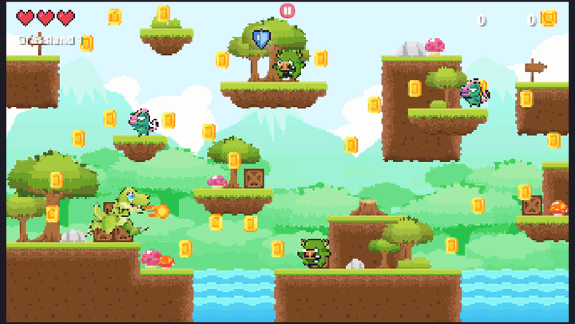
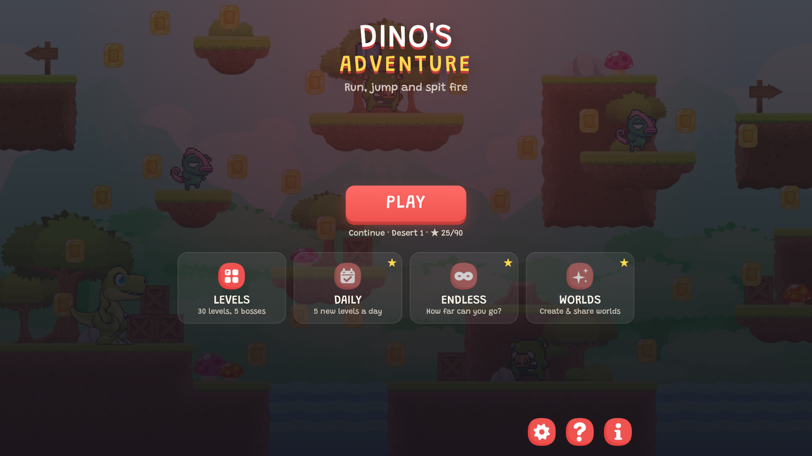
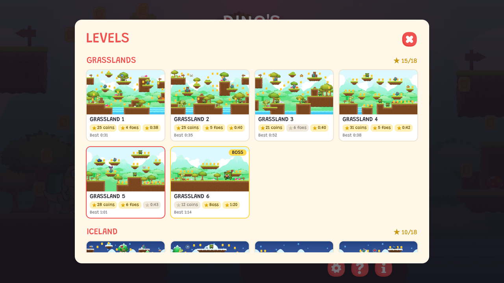
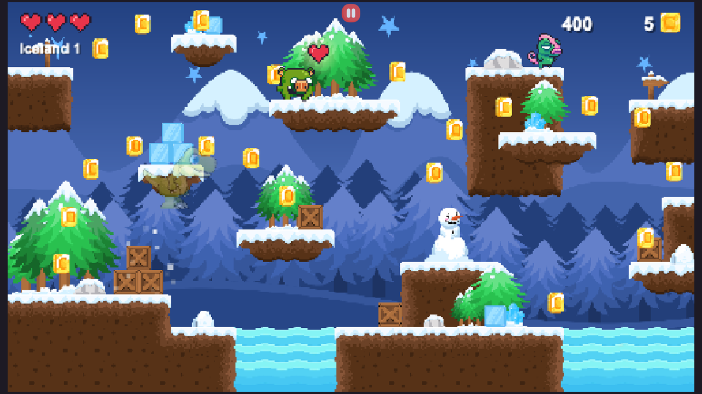
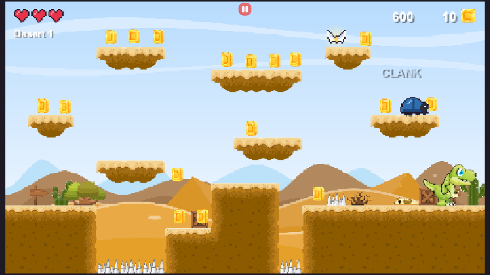
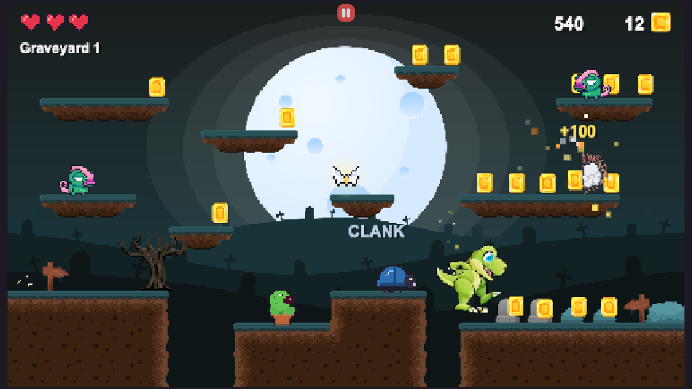
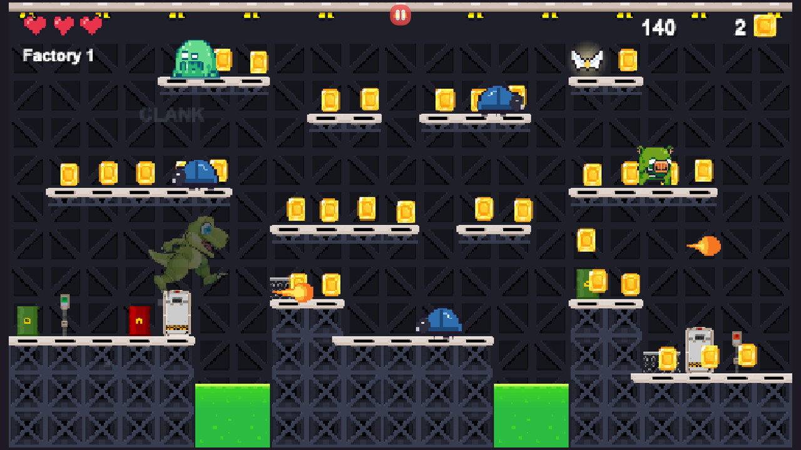
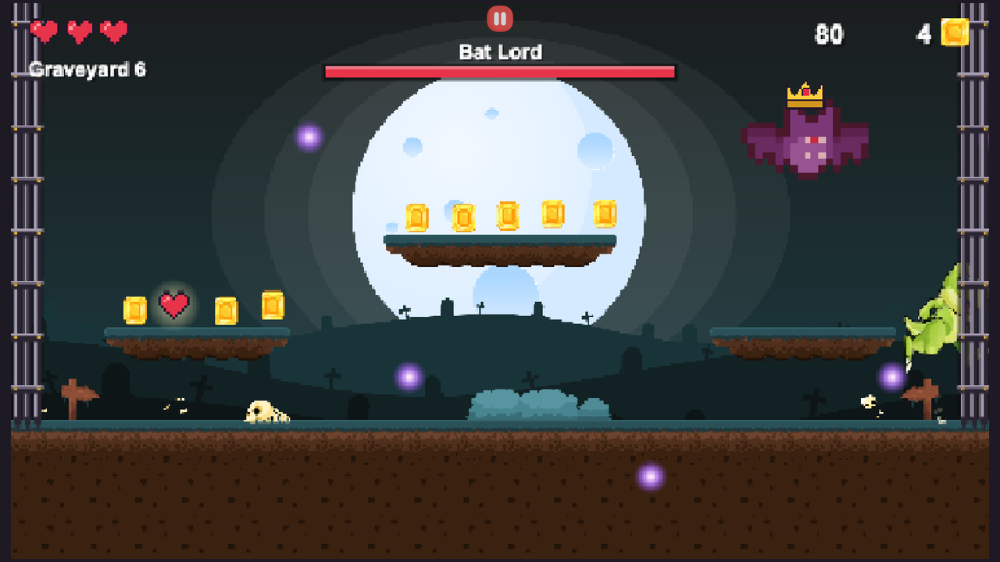
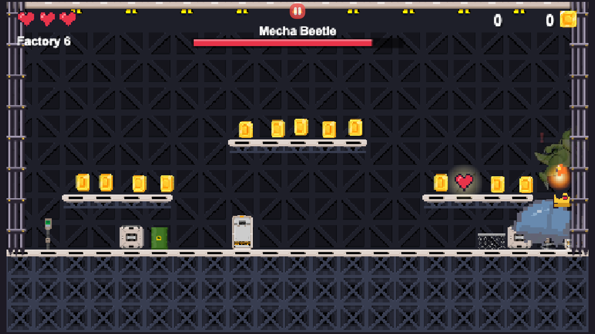

# Dino's Adventure

Dino's Adventure is a platformer game made with a pixel art style.<br />
Goal of this game is to help Dino collect coins and defeat enemies on his way.<br /><br />
Game is made entirly using `Vanilla JS`, `HTML5 Canvas`, and
`CSS`.
<br />
Game is also mobile responsive and can be installed on mobile/desktop as a PWA.<br /><br />



## Screenshots

| Home                                            | Level select                                            |
| ----------------------------------------------- | ------------------------------------------------------- |
|        |             |
| **Iceland**                                     | **Desert**                                              |
|         |                   |
| **Graveyard**                                   | **Factory**                                             |
|     |                 |
| **Boss: Bat Lord**                              | **Boss: Mecha Beetle**                                  |
|  |  |

## Live

The game is live at [dino.spanion.in](https://dino.spanion.in) (Firebase Hosting). The Play Store
app (`packages/android`) opens the same domain from version 1.1; older installs open the
previous [GitHub Pages](https://akaspanion.github.io/platformer-game/) copy until they
update.

## Locally

Needs Node.js 26 (`.nvmrc`) and [pnpm](https://pnpm.io) (the version in `package.json`'s
`packageManager`). Clone the repo and run

```bash
pnpm install
pnpm serve
```

Game will launch at `http://localhost:2108/`

## Controls

- ← / → or A / D: move
- ↑ or Space: jump (again in the air with Wings)
- Enter or Shift: fire (Enter also starts, resumes, or retries from the menus)
- Esc or P: pause / resume (the game also pauses when the tab is hidden)

On phones and tablets the touch buttons scale with the screen (Settings → Touch buttons),
respect notches and gesture bars, and buzz on hits. The game is landscape-only: the web
manifest and the Android TWA lock the orientation, and a browser in portrait shows a
"turn your phone" prompt.

## Gameplay

- **3 hearts.** Enemies, seeds and spike traps cost a heart (with a short knockback and
  blink); falling in a pit costs a heart and puts you back on the last safe ground.
- **One fireball, one kill.** Beetles are armoured and take two.
- **Enemies:** pig, slime, chameleon and beetle walk and lunge at you when you get close
  (they crouch and flash first); bats swoop at you from above; spitter plants shoot seeds
  (a fireball burns a seed).
- **Power-ups:** heart (+1), shield (blocks one hit), triple fire (15s), wings (double
  jump, 20s).

## Worlds and levels

Five worlds of six levels each (30 in all): Grasslands, Iceland, Desert, Graveyard and
Factory. **Level 6 of every world is a boss battle** with an HP bar, and each boss fights
its own way, harder world by world (more health, quicker wind-ups, shorter breaks, chained
attacks in a final phase):

| Boss           | Health | Attacks                                                              |
| -------------- | ------ | -------------------------------------------------------------------- |
| King Pig       | 12     | charge, stomp (rolling seeds), summons piglets                       |
| Frost Slime    | 16     | triple bounce, icicle rain on marked spots, splits when hurt         |
| Sand Chameleon | 20     | vanishes and reappears behind you, tongue lash, sand fan, charge     |
| Bat Lord       | 24     | swoop dives, rings of sonic orbs, bat swarm                          |
| Mecha Beetle   | 28     | rocket charge that bounces back, missile barrage, floor laser, quake |

Every attack is telegraphed (a "!", a tremble or crouch, ground marks or a red line). Both
arena gates shut when the fight starts and lift when the boss falls. Beating the Factory
boss finishes the campaign.

**Unlocking:** the level select only opens a level once you have walked into it in the
campaign. Play continues from the last level you reached. On localhost (or with `?debug`) every
level is open for testing; Settings has a developer switch to turn that off, and only real
progress is saved.

**Stars:** each level has three, shown on its card in the level select: all coins, all
enemies (or the boss), and finishing under the target time. A level counts as finished
when you leave it through its exit; each star, once earned, is kept, along with your best
time.

Grassland 1–3 and Iceland 1–2 are hand-made; the rest come from the level generator (PCG)
in `app/pcg/generator.js`, which the game also runs in the browser. Story levels are
written to `app/areas` with

```bash
pnpm levels
```

which also renders the level-select thumbnails (`scripts/generate-thumbnails.py`).
Every level is checked for reachability with the player's jump physics (entry to exit and
back, every coin and power-up) before it is used. Ground stays low, like Grassland 1–2,
and the space above is filled with tiers of floating platforms.

## Free modes

- **Daily challenge:** 5 generated levels from today's date, the same for everyone, with a
  global leaderboard, a streak and a shareable result.
- **Endless:** generated forever, one level ahead, getting harder.

## Premium features

Premium covers the features that use AI. Today that is Worlds, behind the premium flag
(`app/util/premium.js`; unlock locally with `?premium=1` or the developer switch in
Settings on localhost):

- **Worlds (create & share):** describe a world in words and the game builds all of it:
  6 levels (5 + a boss arena), its own pixel-art tiles, backdrop, decorations and liquid,
  2-4 new enemies (walkers, flyers, turrets), a crowned boss with a move set picked from
  the boss attacks, chiptune music (a world theme and a boss battle theme) and creature /
  boss sounds. Every world is shared straight away with every player. This is the only
  mode that needs a sign-in (Google, or email and password).

Build flag: `PREMIUM=1` (premium on by default, for test builds).

### How created worlds work

The AI (Claude, in the `designWorld` Cloud Function) only writes a small **world spec**
(`app/worlds/spec.js`): palette, surface style, pits, skyline, decor, creature designs,
the boss and its moves, music mood / tempo / lead voice, difficulty. Each device then
generates the assets from the spec with a seeded RNG (`app/gen`): sprites are painted
into pixel buffers, music and sounds are synthesized to WAV, and the level generator
builds and checks the 6 levels. So a shared world is a few KB of JSON, every player
gets the same world, and every level is checked to be beatable. When the designer
can't be reached the game uses an offline keyword designer.

Shared worlds live in Firestore (`worlds` collection). Players read them directly and
get new ones live (`onSnapshot`); only the `publishWorld` function writes them, after
validating each world with the same `sanitizeWorld` the game uses and stamping the
author from the player's ID token. Firebase is a separate chunk, loaded only when a
player opens Worlds (or signed in before), so the game itself starts as fast as ever.

| Piece                                    | Where                                             |
| ---------------------------------------- | ------------------------------------------------- |
| World spec, validation, offline designer | `app/worlds/spec.js`                              |
| Shared repository (Firestore / local)    | `app/worlds/repository.js`                        |
| Sign-in (facade, Firebase backend)       | `app/auth/index.js`, `app/firebase/auth.js`       |
| Firebase loader, Firestore + functions   | `app/firebase/index.js`, `app/firebase/worlds.js` |
| Art: creatures, bosses                   | `app/gen/creatures.js`                            |
| Art: tiles, backdrop, decor, liquid      | `app/gen/scenery.js`                              |
| Music and sound effects                  | `app/gen/audio.js`                                |
| Build a world, register with the engine  | `app/gen/index.js`                                |
| Functions: AI designer, publishing       | `functions/` (see `functions/README.md`)          |
| Firestore rules                          | `firestore.rules`                                 |

### Firebase locally

```bash
pnpm emulators   # Auth, Firestore, Functions (+ Hosting) emulators
pnpm dev         # then open http://localhost:2108/?emulators=1
```

The dev server proxies the emulators, so the game, Auth, Firestore and Functions share
one origin. `?emulators=0` switches back to the real project. Put a key in
`functions/.secret.local` (`ANTHROPIC_API_KEY=...`) to try the AI designer locally.

### Deploying

Pushes to `master` run CI and deploy Hosting, Functions and the Firestore rules and
indexes (`.github/workflows/firebase-hosting-merge.yml`); pull requests get CI and a
Hosting preview channel. By hand: `firebase deploy`.

## Sprites

The bat, beetle, spitter plant, attack poses, power-up icons and 8-frame death
animations are generated pixel art (Python 3 with Pillow):

```bash
pnpm sprites
```

## Music and sound

Each world plays its own track (`grasslands`, `iceland`, `desert`, `dungeon` for the
Graveyard, `lab` for the Factory). Boss arenas switch to a battle theme per boss
(`boss-<kind>.mp3`); after the win a fanfare plays and the world's track comes back.
Enemies have their own attack and death sounds, and every boss move, roar, projectile and
gate has a sound. The boss music and sound effects are synthesized chiptune made by
`pnpm audio` (`scripts/generate-audio.py`, needs ffmpeg for the MP3s).

## Tests

`pnpm test` runs headless tests (esbuild + `node:test`): combat, hearts and pits,
power-ups, enemy attacks and the new enemies, Dino animation states, level integrity for
every story level (spawns, portals, footing, coins), the generator across all themes and
difficulties, daily/endless/custom modes, the world creator (spec validation, generated
art and music, 6-level worlds, generated boss fights, sign-in, the shared repository, the
functions' validation and rate limits), and
a random-input fuzz run on every level.

Open the game with `?debug` (e.g. `http://localhost:2108/?debug`) to get `window.debugGame`
in the console for poking at the running game.

## Author

Ankit Kumar Pandit
